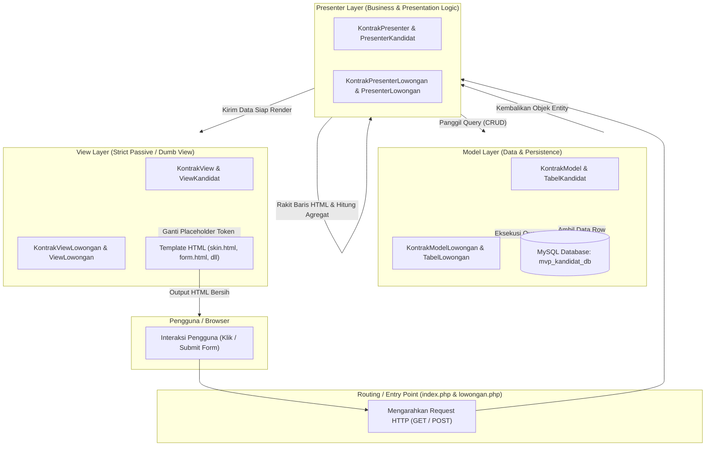
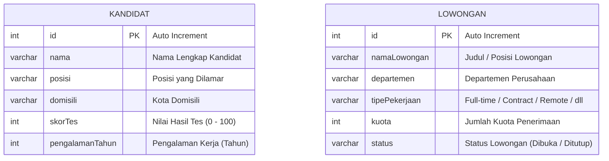
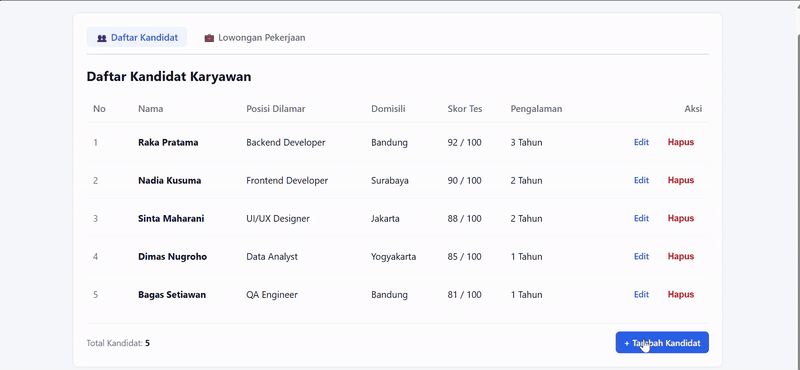

# TP9DPBO2526C1 - TUGAS PRAKTIKUM 9 & 10 DPBO (MODEL-VIEW-PRESENTER / MVP)

<div align="center">


</div>

## JANJI
> Saya **Najib Nurohman** dengan NIM **2509653** mengerjakan **Tugas Praktikum 9 & 10** dalam mata kuliah **Desain Pemrograman Berorientasi Objek (DPBO)** untuk keberkahan-Nya maka saya tidak akan melakukan kecurangan seperti yang telah dispesifikasikan. Aamiin.

---

## 📌 DESKRIPSI SISTEM
Aplikasi ini adalah **Sistem Informasi Manajemen Rekrutmen & SDM (Human Resources)** berbasis web yang dikembangkan menggunakan arsitektur **Model-View-Presenter (MVP)** dengan pendekatan **Strict Passive View (*Dumb View*)** menggunakan **PHP Native** dan **MySQL/MariaDB**.

Sistem ini mengelola dua modul utama dalam proses rekrutmen:
1. **Modul Kandidat Karyawan (`kandidat`)**: Mengelola data calon kandidat pelamar yang mencakup nama, posisi yang dilamar, domisili, skor tes seleksi, serta pengalaman kerja dalam tahun. Data ditampilkan terurut secara descending berdasarkan perolehan skor tes tertinggi.
2. **Modul Lowongan Pekerjaan (`lowongan`)**: Modul tambahan HR untuk mengelola posisi lowongan pekerjaan yang dibuka pada perusahaan, mencakup judul lowongan, departemen, tipe pekerjaan (Full-time, Part-time, Contract, Remote, Internship), kuota penerimaan karyawan, serta status ketersediaan lowongan (*Dibuka* atau *Ditutup*).

---

## 🏛️ DESAIN ARSITEKTUR MVP (STRICT PASSIVE VIEW)

Modul ini mengimplementasikan pola **Model-View-Presenter (MVP)** dengan modifikasi **Strict Passive View**:



### Karakteristik Utama Implementasi:
1. **View Bebas dari Logika Bisnis & Perulangan**:
   - Komponen `View` tidak memiliki `foreach`, `count()`, maupun dependensi ke kelas `Model` atau `Entity`.
   - Tugas `View` murni membaca file template HTML dan mengganti token placeholder (seperti `{{TABLE_ROWS}}`, `{{TOTAL_DATA}}`, `{{FORM_TITLE}}`, dll.) dengan string yang sudah disiapkan oleh Presenter.
2. **Presenter sebagai Pusat Kendali (*Orchestrator*)**:
   - `Presenter` menjadi mediator tunggal antara Model dan View.
   - Mengambil data dari `Model`, melakukan perhitungan total, merakit tag baris tabel (`<tr>...</tr>`) beserta tombol aksi, lalu memerintahkan `View` untuk merender tampilan.
   - Menangani operasi simpan (*Create/Update*) dan hapus (*Delete*) data lalu mengarahkan navigasi (*redirect*).
3. **Penerapan Kontrak Komunikasi Menggunakan Interface**:
   - Seluruh interaksi antar komponen mengacu pada interface:
     - `KontrakModel` & `KontrakModelLowongan` (Model Contract)
     - `KontrakPresenter` & `KontrakPresenterLowongan` (Presenter Contract)
     - `KontrakView` & `KontrakViewLowongan` (View Contract)
   - Hal ini memastikan abstraksi, pemutusan ketergantungan (*decoupling*), kemudahan pengujian mandiri (*testability*), dan kerja paralel.
4. **Keamanan Eksekusi Database**:
   - Menggunakan objek `PDO` dengan *Prepared Statements* dan *Parameter Binding* untuk mencegah celah keamanan SQL Injection.

---

## 🗄️ STRUKTUR BASIS DATA

Database yang digunakan bernama `mvp_kandidat_db` yang memuat 2 tabel:



---

## 📁 STRUKTUR DIREKTORI REPOSITORI

Struktur direktori disusun rapi sesuai spesifikasi Modul 10:

```
TP9DPBO2526C1/
├── project/
│   ├── index.php                      # Entry point & controller modul Kandidat
│   ├── lowongan.php                   # Entry point & controller modul Lowongan
│   ├── mvp_db.sql                     # Script database & data awal di dalam project
│   ├── README.md                      # Catatan modul praktikum
│   ├── models/
│   │   ├── DB.php                     # Koneksi basis data PDO & helper query
│   │   ├── Kandidat.php               # Entitas data Kandidat
│   │   ├── KontrakModel.php           # Interface Model Kandidat
│   │   ├── TabelKandidat.php          # Implementasi query database Kandidat
│   │   ├── Lowongan.php               # Entitas data Lowongan
│   │   ├── KontrakModelLowongan.php   # Interface Model Lowongan
│   │   └── TabelLowongan.php          # Implementasi query database Lowongan
│   ├── presenters/
│   │   ├── KontrakPresenter.php       # Interface Presenter Kandidat
│   │   ├── PresenterKandidat.php      # Presenter & logika tabel Kandidat
│   │   ├── KontrakPresenterLowongan.php # Interface Presenter Lowongan
│   │   └── PresenterLowongan.php      # Presenter & logika tabel Lowongan
│   ├── views/
│   │   ├── KontrakView.php            # Interface View Kandidat
│   │   ├── ViewKandidat.php           # Implementasi Passive View Kandidat
│   │   ├── KontrakViewLowongan.php    # Interface View Lowongan
│   │   └── ViewLowongan.php           # Implementasi Passive View Lowongan
│   └── template/
│       ├── form.html                  # Template HTML formulir Kandidat
│       ├── skin.html                  # Template HTML daftar tabel Kandidat
│       ├── form_lowongan.html         # Template HTML formulir Lowongan
│       └── skin_lowongan.html         # Template HTML daftar tabel Lowongan
├── dokumentasi/
│   ├── README.md                      # Petunjuk & tautan dokumentasi video
│   ├── demo.gif                       # Animasi demonstrasi pengujian CRUD (opsional)
│   └── screenrecord.mp4               # Rekaman video pengujian program
├── mvp_db.sql                         # File export database terbaru
├── .gitignore                         # Konfigurasi file yang diabaikan Git
└── README.md                          # Dokumentasi lengkap sistem
```

---

## 🔄 PENJELASAN ALUR KERJA SISTEM (CRUD FLOW)

### 1. Alur Menampilkan Data (Read / List)
1. Pengguna membuka URL aplikasi melalui browser (misal `localhost/MVP_Kandidat/index.php` atau `lowongan.php`).
2. Script routing menginstansiasi Model, View, dan Presenter yang bersangkutan.
3. Presenter memanggil method `getAll...()` dari Model untuk mengambil data dari MySQL.
4. Model menjalankan query SELECT dengan PDO prepared statement, memetakan setiap baris data ke objek Entity, dan mengembalikannya ke Presenter.
5. Presenter menghitung total data dan merakit markup HTML `<tr>` untuk setiap baris data.
6. Presenter memanggil method `renderDaftar($tableRowsHtml, $totalData)` pada View.
7. View mengganti token `{{TABLE_ROWS}}` dan `{{TOTAL_DATA}}` pada template `skin.html` / `skin_lowongan.html` lalu menampilkannya ke layar.

### 2. Alur Tambah Data (Create)
1. Pengguna menekan tombol `+ Tambah Kandidat` atau `+ Tambah Lowongan`.
2. Router mendeteksi parameter `?screen=add` dan memanggil `tampilkanForm...()` pada Presenter tanpa parameter ID.
3. Presenter memanggil `renderForm()` pada View dengan title `"Tambah ... Baru"`, action `"tambah"`, dan form data kosong.
4. Pengguna mengisi formulir dan menekan tombol **Simpan**.
5. Form mengirimkan request HTTP `POST` dengan nilai `action = 'tambah'`.
6. Router menangkap data input `POST` lalu memanggil method `tambah...()` pada Presenter.
7. Presenter memerintahkan Model untuk menjalankan query INSERT INTO menggunakan prepared statement.
8. Setelah data berhasil tersimpan, Presenter melakukan pengalihan (*redirect*) kembali ke halaman utama.

### 3. Alur Ubah Data (Update)
1. Pengguna menekan tombol **Edit** pada salah satu baris data.
2. Router mendeteksi parameter `?screen=edit&id=X` lalu memanggil `tampilkanForm...(id)` pada Presenter.
3. Presenter meminta data entitas dari Model via `get...ById(id)`.
4. Presenter menyusun array `$formData` dan memanggil method `renderForm()` pada View.
5. View mengisi atribut `value` elemen input dengan token data lama (prefill data).
6. Pengguna mengedit kolom yang diinginkan lalu menekan **Simpan**.
7. Request HTTP `POST` dengan `action = 'ubah'` dan `id = X` diterima oleh router.
8. Presenter memanggil method `update...()` pada Model untuk mengeksekusi query UPDATE WHERE id = :id.
9. Pengguna dialihkan kembali ke halaman utama dengan data yang telah terbarukan.

### 4. Alur Hapus Data (Delete)
1. Pengguna menekan tombol **Hapus** pada baris data.
2. Muncul dialog konfirmasi JavaScript (`confirm`). Jika pengguna menyetujui, form dikirim via method `POST` dengan `action = 'hapus'` dan `id = X`.
3. Presenter mengeksekusi method `delete...()` pada Model yang menjalankan query DELETE FROM WHERE id = :id.
4. Setelah record dihapus dari database, Presenter mengarahkan kembali ke halaman utama.

---

## 🚀 PANDUAN INSTALASI & MENJALANKAN PROGRAM

1. **Prasyarat**:
   - Web Server Apache & Basis Data MySQL (tersedia melalui **XAMPP** atau **Laragon**).
   - PHP versi 8.0 ke atas dengan ekstensi PDO MySQL aktif.
2. **Import Basis Data**:
   - Buka control panel XAMPP / Laragon, aktifkan modul **Apache** dan **MySQL**.
   - Buka phpMyAdmin di browser: `http://localhost/phpmyadmin/`.
   - Buat database baru atau langsung impor file `mvp_db.sql` yang tersedia pada root repositori ini.
   - Impor akan secara otomatis menyiapkan database `mvp_kandidat_db` serta tabel `kandidat` dan `lowongan` lengkap dengan data awal.
3. **Penempatan Proyek di Web Server**:
   - Salin isi folder `project/` ke dalam direktori web server:
     - Untuk XAMPP: `C:\xampp\htdocs\MVP_Kandidat\`
     - Untuk Laragon: `C:\laragon\www\MVP_Kandidat\`
4. **Menjalankan di Browser**:
   - Akses Modul Kandidat:
     ```
     http://localhost/MVP_Kandidat/index.php
     ```
   - Akses Modul Lowongan:
     ```
     http://localhost/MVP_Kandidat/lowongan.php
     ```
   - Pengguna dapat berpindah halaman secara fleksibel menggunakan navigasi tab di bagian atas tampilan.

---

## 📹 DOKUMENTASI DEMONSTRASI PROGRAM

Berikut adalah demonstrasi animasi pengujian alur program (fitur Create, Read, Update, Delete untuk modul Kandidat dan Lowongan):

<div align="center">
  
</div>

### File Media Demonstrasi:
- **Animasi GIF Demonstrasi**: [demo.gif](dokumentasi/demo.gif)
- **Video Asli Resolusi Penuh**: [TP10_Demo.mp4](dokumentasi/TP10_Demo.mp4)

---

<div align="center">
  <sub>Tugas Praktikum Desain & Pemrograman Berorientasi Objek (DPBO) © 2026 Najib Nurohman</sub>
</div>
